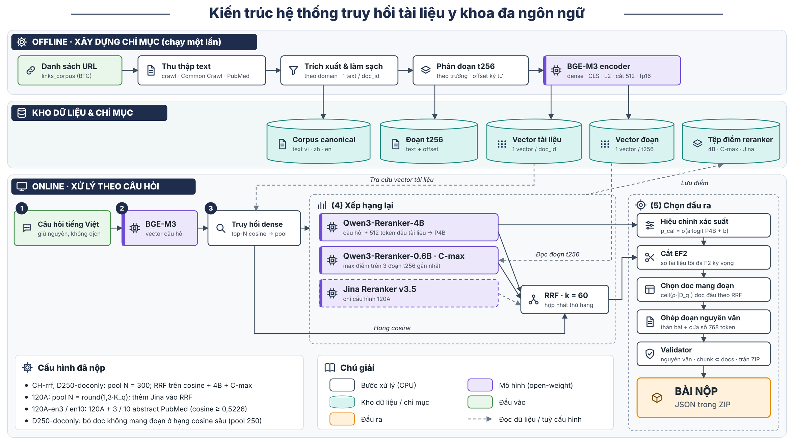
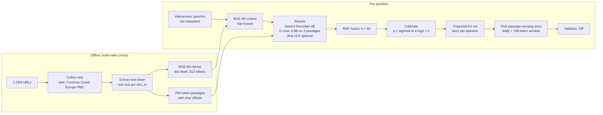

# vimed-xretrieval

Cross-lingual medical document retrieval: a Vietnamese question goes in; relevant Vietnamese, Chinese and English documents come out, each with verbatim evidence passages. Built for Road to AI 2026, Stage 3 (AI Guru), on the ViBioMIR benchmark.


## Highlights

- **1st prize, Road to AI 2026** (Stage 3, medical retrieval track). Solo project: data collection, retrieval, ranking, evaluation and release.
- **Chunk F2 0.386 vs 0.194** for the organizers' reference baseline on the public leaderboard, even though our score was measured under the stricter passage-matching rule introduced on 23 Oct.
- **Final score 0.418 vs 0.376 baseline** under the same metric version (public leaderboard, 22 Oct).
- **1.22M-URL trilingual corpus**: built a text corpus of 1.20M documents (usable text for 97.7% vi, 94.8% zh, 99.7% en URLs) from public web sources, Common Crawl and Europe PMC, with per-document provenance.
- **Optimizes F2 directly**: Platt-calibrated reranker probabilities plus an expected-F2 cut choose how many documents to return per question, instead of a fixed top-K.
- **Deterministic, byte-exact rebuild**: the final submission ZIPs are rebuilt from saved scores on CPU and checked byte for byte against the submitted files; 1,083 unit tests.

## Problem

- **Input:** a medical question in Vietnamese and a fixed list of 1,220,598 document URLs in Vietnamese, Chinese and English (only URLs; participants collect the text).
- **Output:** for each question, a list of relevant document IDs and up to two verbatim passages per returned document.
- **Metric:** Final = mean of Doc F2 and Chunk F2. A returned passage matches a gold passage when their longest common subsequence covers at least 40% of the gold passage and, from 23 Oct, also at least 40% of the returned passage.
- **Why it is hard:**
  - cross-lingual: Vietnamese questions, while many relevant documents are Chinese;
  - broad relevance: each question has many relevant documents, and the right output length differs strongly between questions;
  - F2 weights recall four times more than precision, so returning too few documents is costly, but every extra document still lowers precision;
  - no text is provided: coverage of the corpus depends on crawling.

## Architecture



*Diagram labels are in Vietnamese (from the Demo Day slides). Top: offline indexing (URL list → text collection → extraction and cleaning → 256-token passages → BGE-M3 encoder). Middle: stored corpus, passages, vectors and reranker scores. Bottom: per-question flow (1) question, (2) BGE-M3, (3) dense retrieval, (4) reranking with RRF, (5) output selection.*

<details>
<summary>Text version of the diagram</summary>



</details>

1. **Dense retrieval.** BGE-M3 embeds each document once (title + body, first 512 tokens) and each question at query time. The top-N documents by cosine form the candidate pool (N = 300 in the final configuration).
2. **Reranking.** Each (question, document) pair is scored by Qwen3-Reranker-4B on the first 512 tokens, and by **C-max**: Qwen3-Reranker-0.6B on the three 256-token passages closest to the question, keeping the maximum. C-max finds answers deep in long documents. One configuration adds Jina Reranker v3.5. Rankings are merged with Reciprocal Rank Fusion (k = 60) together with the cosine ranking.
3. **Output size by expected F2.** The 4B score is calibrated to a probability, p = σ(a · logit + b). Walking down the fused ranking, the system returns the k documents that maximize the expected F2, 5 · Σ p_i / (4 · G_q + k), where G_q is the expected number of relevant documents for that question. All constants are global and fixed in config files.
4. **Passage-carrying documents.** Only the top part of each returned list carries passages, so passage precision does not fall with document count.
5. **Passages.** The verbatim document body; if the body is longer than 1,536 tokens, a 768-token window around the best 256-token passage is added. A validator checks every passage is an exact substring of its document before packaging.

No model is fine-tuned and no generative LLM is used: every returned passage is an exact substring of a source document.

## Results

Public leaderboard, scored by the organizers. The passage-matching rule changed on 23 Oct (metric v1 → v2); scores are only comparable within one version. Re-scoring the same submission file under v2 lowered its Chunk F2 from 0.423 to 0.359.

| Step | Metric | Final | Doc F2 | Chunk F2 |
|---|---|---:|---:|---:|
| Organizers' reference baseline (BM25 + BGE-M3 + RRF + bge-reranker-v2-m3) | v1 | 0.376 | 0.559 | 0.194 |
| First submission (early index, 124k documents) | v1 | 0.063 | | |
| BGE-M3 hybrid retrieval + reranking, full crawl (P1) | v1 | 0.283 | 0.290 | 0.277 |
| Document-level dense retrieval over the whole corpus | v1 | 0.375 | 0.381 | 0.369 |
| + Qwen3-Reranker-4B, calibrated probability cut | v1 | **0.418** | 0.414 | 0.423 |
| Same system family after the rule change | v2 | 0.386 | 0.418 | 0.354 |
| + 73,000 Chinese documents recovered from 120ask | v2 | 0.411 | 0.439 | 0.383 |
| Final configuration (4B + C-max RRF, expected-F2 cut, RRF-ordered passages) | v2 | **0.414** | **0.441** | **0.386** |

The baseline returns about 30–38 documents per question at high precision (Doc P 0.88). Our system returns about 184 at Doc P 0.23 and Doc R 0.66, which F2 rewards on passages but not on documents. The gain comes mainly from the passage side.

## Key findings

- **Document-level embeddings beat passage-level ones.** On an independent 50-question set with graded labels, BGE-M3 on whole documents (first 512 tokens) reached nDCG@10 0.729 vs 0.696 for BGE-M3 on 256-token passages and 0.706 for BM25. On the leaderboard, ranking by document-level cosine moved Final from 0.294 to 0.321 on the old candidate pool, and to 0.375 when applied to the whole corpus.
- **A stronger reranker plus a probability cut adds about +0.04.** From 0.382 (per-question document count taken from the earlier system) to 0.418 with Qwen3-Reranker-4B and the calibrated expected-F2 cut (metric v1).
- **Calibration holds on average and drifts at depth.** Over all returned documents, measured precision / mean predicted probability = 0.92; for documents at cosine rank 251–300 that do not carry passages, the ratio falls to about 0.3. The model is overconfident in the tail.
- **Simple global rules beat fitted ones.** Replacing the expected-F2 cut with a learned per-question document count lost 0.014. A calibration refit on leaderboard aggregates predicted that returning fewer documents would raise Doc F2 by about 0.04; on the leaderboard, Doc F2 fell by 0.004.
- **Data coverage limited results more than ranking did.** Recovering 73,000 Chinese pages that timed out from our main machine (re-crawled at 1 request/s from a separate server) added +0.017 Final. In the final-week ablations, about half of the single ranking changes moved Final by 0.003 or less.

## Reproduce

Building the submission files from saved reranker scores needs only a CPU.

| Task | Hardware | Time |
|---|---|---|
| Rebuild all submissions from saved scores (`--all`) | CPU, ≥ 16 GB RAM, ≥ 60 GB free disk | about 4 h 25 min (Intel Core i5-13420H, Windows 11 + Git Bash) |
| Re-score with Qwen3-Reranker-4B (optional) | 2× T4 (Kaggle) | about 15 h per 360,000 pairs |
| Re-score C-max and Jina (optional) | GPU ≥ 6 GB | C-max about 10 h |

```bash
# 1. Install (Python 3.11–3.13, tested on 3.12)
git clone https://github.com/TranVu2005/vimed-xretrieval vimed-xretrieval && cd vimed-xretrieval
python -m venv .venv && source .venv/bin/activate
python -m pip install -e ".[reproduce,dev]" -c configs/environment.constraints.txt \
    --extra-index-url https://download.pytorch.org/whl/cu128

# 2. Data: download data/ (8 r2ai-*.tar packages) and SHA256SUMS from
#    https://drive.google.com/drive/folders/1NUw099da7rR4zd_j3pg_acTUHjfAH09B
sha256sum -c SHA256SUMS --ignore-missing
export R2AI_ROOT=/path/to/r2ai-root && mkdir -p "$R2AI_ROOT"
for t in data/r2ai-*.tar; do tar -xf "$t" -C "$R2AI_ROOT"; done
hf download AIGuruTinix/ViBioMIR query.parquet links_corpus_vi_en_zh.parquet \
    --repo-type dataset --local-dir "$R2AI_ROOT/data/raw"

# 3. Tokenizers (pinned revisions, see MODELS.md)
export HF_HOME=$R2AI_ROOT/hf_home
hf download BAAI/bge-m3 --revision 5617a9f61b028005a4858fdac845db406aefb181
hf download Qwen/Qwen3-Reranker-0.6B --revision e61197ed45024b0ed8a2d74b80b4d909f1255473
export HF_HUB_OFFLINE=1

# 4. Rebuild and verify: prints PASS only when each ZIP matches the submitted file byte for byte
python -m r2ai.reproduce --root "$R2AI_ROOT" --all

# 5. Tests
python -m pytest -q
```

Step-by-step guide with checks after each step and common errors: [`docs/REPRODUCE.md`](docs/REPRODUCE.md) (Vietnamese). Package contents: [`DATA.md`](DATA.md). Model revisions: [`MODELS.md`](MODELS.md). Package versions that affect output bytes are pinned in `configs/environment.constraints.txt`.

## Repository structure

```
src/r2ai/          library: indexing, retrieval, reranking, output selection, passages, validator
  reproduce.py     entry point: rebuild and byte-check submissions
  s29 … s43/       modules named after development rounds (see docs/ARCHITECTURE.md)
src/vicrawl/       resumable async crawler and per-domain extractors
scripts/           reproduction scripts (reproduce_*.sh), index building, scoring
configs/           pinned output-selection configs and inputs, environment constraints
archive/           configs of experiments not used by any submission, with outcomes
notebooks/         Kaggle notebooks for Qwen3-Reranker-4B scoring
deploy/s37/        rate-limited crawler for one Chinese site, run on a separate server
tests/             pytest suite with HTML fixtures
tools/             data packaging, PDF export
docs/              technical report, reproduction guide, code map (Vietnamese)
figures/           architecture diagram (Demo Day slides) and detailed pipeline diagram
```

Pinned configs record input paths of the development machine; `R2AI_PIN_ORIGIN` maps them onto the local data root, so they are left unchanged to keep the rebuild byte-exact. Module names such as `r2ai.s36` are development-round numbers. They are kept because pinned configs and the byte-exact rebuild import them; [`docs/ARCHITECTURE.md`](docs/ARCHITECTURE.md) maps each module to its function.

## Tech stack

- **Models (open-weight, not fine-tuned):** BGE-M3 (dense embeddings), Qwen3-Reranker-4B, Qwen3-Reranker-0.6B, Jina Reranker v3.5
- **ML:** PyTorch, Hugging Face Transformers, vLLM (optional scoring backend), NumPy, SciPy
- **Data:** Polars, PyArrow, pandas, Parquet, zstd
- **Collection:** httpx, trafilatura, lxml, warcio (Common Crawl WARC ranges), Europe PMC REST API
- **Compute:** local CPU, Kaggle 2× T4, rented GPU for reranker scoring
- **Testing:** pytest

## Author and acknowledgements

Trần Xuân Vũ (solo).

Thanks to AI Guru and the Road to AI 2026 organizers for the ViBioMIR benchmark and the evaluation. Models used: BAAI BGE-M3 (MIT), Qwen3-Reranker-4B and 0.6B (Apache-2.0), Jina Reranker v3.5 (CC BY-NC 4.0). Text was collected from public sources and Common Crawl, with provenance; PubMed abstracts via Europe PMC.

## License

- Code: MIT ([`LICENSE`](LICENSE)).
- Models are not redistributed; each keeps its own license. Jina Reranker v3.5 is CC BY-NC 4.0, so the Jina score files in the data package are for non-commercial use only.
- Collected text remains the property of its source sites; the data package is shared only to verify reproduction and grants no redistribution rights. The ViBioMIR dataset belongs to the organizers and is not repackaged.

## Tóm tắt tiếng Việt

- Hệ thống truy hồi tài liệu y khoa đa ngôn ngữ: câu hỏi tiếng Việt → tài liệu tiếng Việt, Trung, Anh kèm đoạn trích nguyên văn, trên bộ ViBioMIR. Giải nhất Road to AI 2026 (Stage 3), làm một mình.
- Pipeline: BGE-M3 dense mức tài liệu → xếp hạng lại bằng Qwen3-Reranker-4B và C-max (0.6B trên 3 đoạn), hợp nhất RRF → hiệu chỉnh xác suất và cắt theo F2 kỳ vọng → đoạn trích = thân bài + cửa sổ 768 token.
- Không fine-tune, không dùng LLM sinh văn bản; mọi đoạn trả về là chuỗi con nguyên văn của tài liệu.
- Tự xây corpus 1,20 triệu tài liệu từ 1,22 triệu URL (web công khai, Common Crawl, Europe PMC), có provenance.
- Leaderboard public: Chunk F2 0,386 so với 0,194 của baseline BTC; Final 0,418 so với 0,376 trên cùng phiên bản metric.
- Bài nộp dựng lại tất định trên CPU, trùng từng byte với tệp đã nộp.
